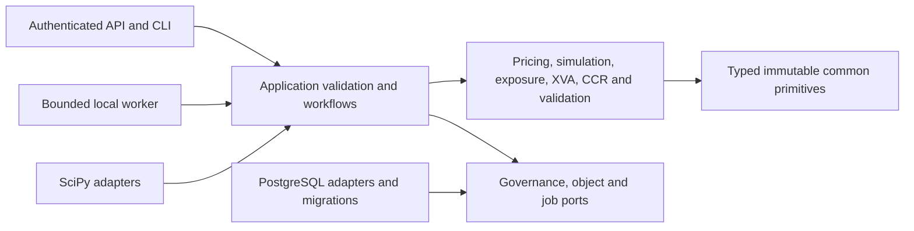

# Parallax Risk

Quantitative counterparty credit risk, XVA and model validation research platform.
**All 12 implementation phases are complete; release 0.12.0.**
The completed release checks are recorded in [Phase 12 evidence](docs/validation/phase-12.md).

The platform prices supported derivatives, calibrates stochastic models, simulates
correlated markets, applies legal netting/cash CSA, computes exposure and additive XVA,
compares restricted standardized CCR/IMM challengers, and challenges outputs with
invariants, sensitivity, convergence, uncertainty, stress, mutation and adversarial search.
It persists model governance, monitoring, findings, decisions and reproducible lineage.
Phase 12 exposes those real engines as authenticated durable API jobs and CLI workflows.

This is research software, with explicit model/financial/operational limitations. It
makes no trading-readiness, regulatory compliance or security certification claim.
Synthetic demonstrations are labelled and small path counts do not prove tail accuracy.



## Install and verify

Python 3.12–3.14 is supported by metadata; local release verification uses 3.13.2 and
installed Linux 3.12.14. Hosted CI is configured for 3.12/3.13; local checks do not prove
its outcome. From the project root:

```sh
python -m venv .venv
# PowerShell: .\.venv\Scripts\Activate.ps1
# POSIX: . .venv/bin/activate
python -m pip install -r requirements-dev.lock
python -m pip install --no-deps -e .
python -m ruff check .
python -m ruff format --check .
python -m mypy
python scripts/check_docs.py
python -m pytest
python -m build
parallax-risk version
```

For live migration/integration tests set PARALLAX_TEST_DATABASE_URL to an explicitly
isolated PostgreSQL test database. Otherwise those tests skip, which is not live database
verification. PowerShell `scripts/verify_phase12.ps1` provides complete isolated Docker
verification and scoped finally cleanup. Use -Focused for new workflow/database checks.
Locks pin versions without artifact hashes; revalidate dependency changes and audit.

## Run the service and full demonstration

[Service operations](docs/operations/SERVICE.md) give exact provisioning, configuration,
fresh migration and Compose steps. Generate a high-entropy key into ignored local files:

```sh
python scripts/create_service_credentials.py --subject researcher --roles reader analyst validator approver operator
```

Set PARALLAX_SERVICE_CREDENTIALS to the generated digest-only credentials.json contents.
Replace every .env.example placeholder in an untracked .env for Compose. Explicitly
start/migrate PostgreSQL to 0012 before starting the API; startup never runs DDL.
Normal Compose retains its persistent database and publishes only loopback API 8000.
The runtime is UID 10001. Remote use requires a trusted HTTPS proxy and tls_proxy mode.

```sh
python scripts/demo_service.py --server http://127.0.0.1:8000 --credential-file artifacts/local/service-credentials/api-key.txt --subject researcher
parallax-risk query --server http://127.0.0.1:8000 --credential-file artifacts/local/service-credentials/api-key.txt --path /v1/governance/model --limit 20
parallax-risk xva --server http://127.0.0.1:8000 --credential-file artifacts/local/service-credentials/api-key.txt --input artifacts/local/phase12/demo/xva-input.json --idempotency-key replay-1 --wait-seconds 180
```

The paced demo ingests exact book/market data, calibrates synthetic Vasicek bonds, feeds
actual fitted parameters to simulation, runs all 16 financial/lab operations, preserves
an open weak-mutation finding and synthetic conditional decision, requires exact retained
XVA replay, and saves seven HTML/JSON report pairs plus retained job inputs.
[Input fixtures](data/sample/service/README.md), [financial assumptions](docs/api/EXAMPLES.md).

All /v1 requests require X-API-Key. Calculations require Idempotency-Key and return 202
with a durable run ID. Identical owner/key/input returns that job; changed input conflicts.
GET /v1/runs/{id}/input, /result and /v1/governance/lineage/{id} expose reproducible evidence.
[API reference](docs/api/ENDPOINTS.md) describes every route and [contracts](docs/methodology/SERVICE.md)
describe nominal schemas, explicit roles, limits, keyset pages and uncertain-job handling.
Public /health is liveness; /ready checks actual DB/schema/workers; /version reports phase 12.

CLI includes price-trade, price-portfolio, calibrate, bootstrap-curve, simulate, exposure,
xva, capital, compare, convergence, invariants, sensitivity, stress, uncertainty, mutate,
adversarial, report, governance-write, ingest and query; each command has --help.
Operational config/run-context/check-db commands remain available. Credentials are file
inputs, never raw command arguments. Imports perform no settings/engine/network/logger IO.

## Navigation and evidence

- [Documentation index](docs/INDEX.md), [codebase guide](docs/CODEBASE_GUIDE.md), [developer guide](DEVELOPMENT.md)
- [Decision register and every phase history](docs/decisions/README.md), [roadmap](ROADMAP.md), [changelog](CHANGELOG.md)
- [Methodology](docs/methodology/INDEX.md), [model cards](docs/models/INDEX.md), [limitations](docs/LIMITATIONS.md)
- [Security](SECURITY.md), [architecture](docs/architecture/OVERVIEW.md), [reproducibility](docs/REPRODUCIBILITY.md)
- [Benchmarks and their limits](docs/validation/SERVICE_BENCHMARKS.md), [final requirement audit](docs/validation/FINAL_AUDIT.md)

Tests use explicit financial tolerances and ≥95% branch-inclusive coverage. Performance
numbers are local measurements with environment/input scope, not guaranteed speedups.
Useful release/rollback images, shared layers/cache and normal project data are retained.
Disposable test cleanup never targets another project's resources or uses global prune.
