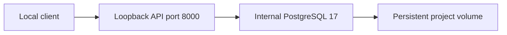

# Current deployment topology

Normal Compose runs API and PostgreSQL 17 on a private project network. Only API
loopback port 8000 is published. PostgreSQL uses a named persistent volume; it is
not published in normal deployment. The multi-stage Python 3.12 image runs as
non-root UID 10001, installs a wheel/runtime lock and checks readiness for health.

The verification override uses loopback API 58000 and DB 55432 under a separate
phase-specific Compose project. Those volumes are disposable test data; the normal
project's volume is retained. [Docker operations](../operations/DOCKER.md) explains
ownership checks and cleanup. CI uses its own `parallax-risk-ci` stack and teardown.

This is local research deployment, not a hardened production financial service.
Authentication, financial jobs, scale/HA and release hardening are DEFERRED to Phase 12.

Phase 5 adds pure Python book/collateral functionality within the existing wheel.
No additional service, port or persistent volume is needed. The active disposable
verification project is parallax-risk-phase8-verification; normal database data
and other projects remain outside its cleanup scope.

Phase 6: Pure Python exposure/credit runs in the existing wheel, with no new service/port/data volume. The active disposable verification project is parallax-risk-phase8-verification; normal project data and other workloads remain outside cleanup.
See [exposure workflow](../workflows/EXPOSURE_WORKFLOW.md).

Phase 7 XVA/risk ships in the same typed wheel and existing image, with no new
service, port or persistent volume. The verification helper runs installed production
wheel code in its disposable Linux test container. [Cleanup](../operations/DOCKER.md).

Phase 8 uses the same Python wheel/API/CLI/PostgreSQL topology. CCR is a library research workflow, not a new service, port, financial endpoint or persisted job.
[CCR workflow](../workflows/CCR_WORKFLOW.md), [decisions](../decisions/README.md).

## Phase 9 lab scope

Phase 9 is an installed library/report workflow inside the existing runtime. No validation microservice, persistence table or financial HTTP job is added. The phase-specific verification helper uses disposable labelled resources and preserves other projects.
[Lab methods](../methodology/MODEL_VALIDATION.md), [phase evidence](../validation/phase-9.md).

## Phase 10 applicability

The installed 0.10.0 library runs inside the existing runtime. No adversarial service/database schema is deployed. Disposable verification is scoped to Phase 10 and retains useful images/shared cache and other projects.

[Search methods](../methodology/ADVERSARIAL_SEARCH.md), [phase evidence](../validation/phase-10.md).
