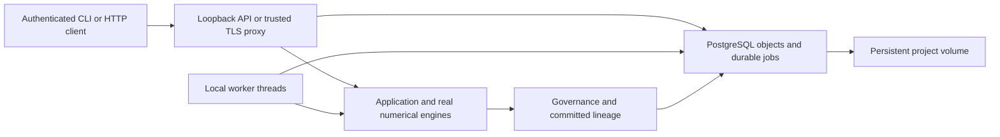

# Current deployment topology

Release 0.12.0 runs an authenticated API and bounded in-process worker threads with
PostgreSQL 17 on a private Compose network. Normal API port 8000 is loopback-only;
PostgreSQL's named volume is persistent and unpublished. The Python 3.12 multi-stage
image installs a wheel/runtime lock and runs as UID 10001. Migrations are explicit.

[Service operations](../operations/SERVICE.md) supply provisioning, explicit 0012 migration,
startup, limits and failure handling. No Redis, process/distributed worker service or
monitoring scheduler is deployed; measured small-job overhead did not justify it.
The BackgroundExecutor port permits future adapters without embedding them in domain.
Remote access needs trusted HTTPS/proxy configuration; static roles are research controls,
not enterprise HA, signed approval or regulatory certification.

Verification uses loopback API 58000/database 55432 under
parallax-risk-phase12-verification. Its containers/network/test volume are disposable
and removed in finally by exact ownership checks. Normal data, other projects, useful
release/rollback images and shared cache stay outside cleanup. CI uses its separate
parallax-risk-ci stack and removes only its owned disposable volumes.
[Phase evidence](../validation/phase-12.md), [security](../../SECURITY.md).
