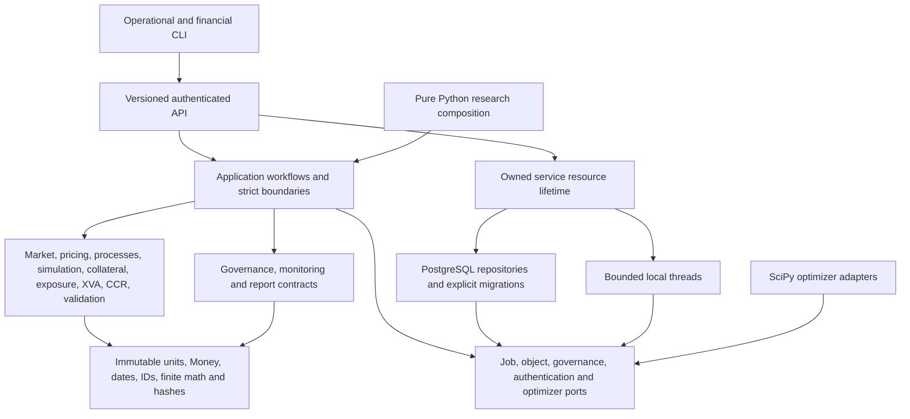

# Architecture overview

Parallax Risk uses one typed src-layout package. Application services orchestrate the
completed financial/lab engines through injected ports; API/CLI validate and compose
resources, infrastructure implements persistence/authentication/compute, and domain
mathematics depend inward on common values.

[Service contracts](../methodology/SERVICE.md) and [deployment](DEPLOYMENT.md) describe
retained evidence, failure states and local operating limits. No financial mathematics
lives in API routers or persistence adapters.

`create_app()` and CLI `main()` own operational dependency lifetimes. `PricingService`
injects engine/logger and returns run-correlated evidence. The pricing library has
no environment/database requirement. `common` logging is isolated and configures no
global logger on import. All package imports are tested for side effects.

CalibrationService injects the CalibrationSolver port/logger. ScipyLeastSquares is
an infrastructure optimizer adapter; immutable objectives and numerical instrument
formulas stay in domain. NumPy/SciPy math dependencies are permitted there; domain
still imports no application, adapter, Pydantic, HTTP or ORM code. Models generate
no random state, paths or import-time IO.

See [components](COMPONENTS.md), [data flow](DATA_FLOW.md),
[dependency rules](DEPENDENCY_RULES.md), [deployment](DEPLOYMENT.md) and the
[historical foundation explanation](foundation.md). Rationale and per-phase changes
are in [decisions](../decisions/README.md), not proof of institutional approval.

Phase 4 adds domain-owned numerical streams, contracts, vectorized kernels and
immutable batch buffers. Application SimulationService injects an engine/observable
port and safe logger; research/benchmark modules orchestrate experiments without
HTTP/ORM dependencies. Scripts/notebooks compose the library. No import-time RNG
is created, and each iteration owns its working state. See [paths](../methodology/MONTE_CARLO.md).

Phase 5 adds immutable legal portfolio/CSA/cash aggregates in domain and an injected
application PortfolioPricer workflow. Financial netting/collateral math remains outside
API/persistence. See [portfolio workflow](../workflows/PORTFOLIO_WORKFLOW.md).

Phase 6: ExposureService injects simulation/portfolio/market ports. Domain exposure and credit own immutable market bindings, statistics and default/dependence mathematics; no financial handler or persistence is introduced.
See [exposure workflow](../workflows/EXPOSURE_WORKFLOW.md).

Phase 7: XvaService injects an XvaCalculator and validates exposure/input evidence;
XvaRevaluation composes actual exposure for each bump. Domain XVA owns financial
contracts, integration, finite differences and attribution. No new financial handler,
persistence dependency or runtime service is added. [Workflow](../workflows/XVA_WORKFLOW.md).

Phase 8 adds pure domain CCR formulas/contract mapping and an injected application legal-unit simulation comparison. Existing dependency direction and resource lifetimes remain unchanged.
[CCR workflow](../workflows/CCR_WORKFLOW.md), [decisions](../decisions/README.md).

## Phase 9 lab scope

Phase 9 extends inward domain validation values/mathematics and injected application model adapters. The lab composes existing exposure/XVA/calibration workflows; no new service, database schema or financial HTTP endpoint is added.
[Lab methods](../methodology/MODEL_VALIDATION.md), [phase evidence](../validation/phase-9.md).

## Phase 10 applicability

Phase 10 adds immutable fault/search/diagnostic evidence, injected application workflows and an infrastructure SciPy optimizer. Script composition injects the adapter; there is no new service or financial HTTP route.

[Search methods](../methodology/ADVERSARIAL_SEARCH.md), [phase evidence](../validation/phase-10.md).

## Phase 11 applicability

Governance values remain in domain; application owns lifecycle validation,
serialization and injected repository/report workflows. Infrastructure implements
PostgreSQL guarded transactional persistence and packaged explicit Alembic
migrations. Scripts compose engines/calibration/search adapters and dispose
owned engines. No SQLAlchemy imports enter domain/application.

[Governance contracts](../methodology/GOVERNANCE.md), [actual phase evidence](../validation/phase-11.md).

## Phase 12 current service scope

The 0.12.0 service adds authenticated versioned financial/lab/governance jobs,
retained inputs/results/lineage, owner-scoped objects/reports and production CLI.
Earlier phase-specific descriptions above record their scope at introduction; current
service behavior is defined by [service contracts](../methodology/SERVICE.md),
[operations](../operations/SERVICE.md) and
[Phase 12 evidence](../validation/phase-12.md). Numerical model limitations remain applicable.
