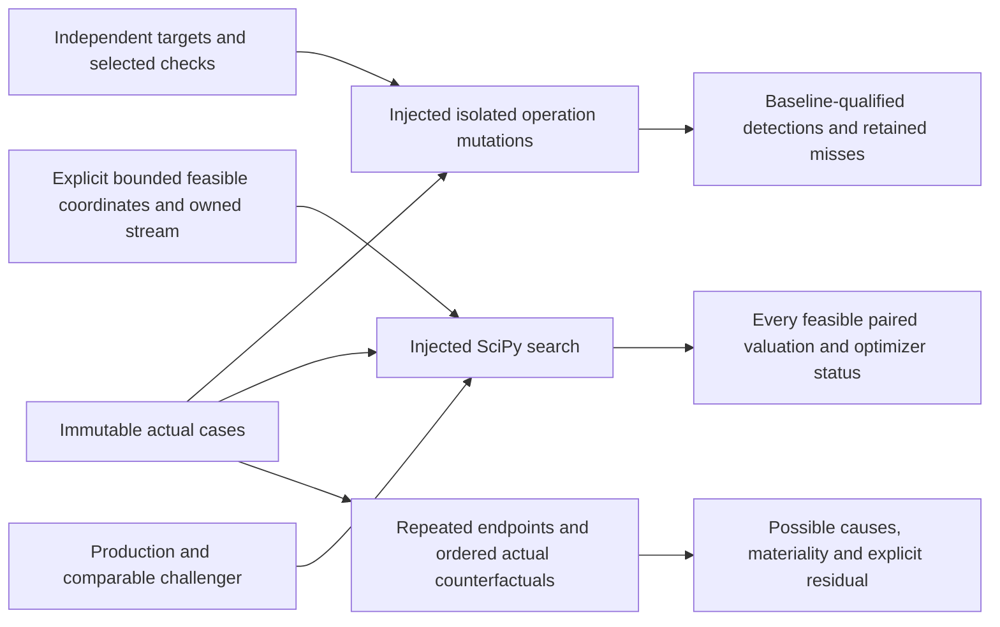

# Mutation, adversarial search and forensic workflow

Run `python scripts/demo_adversarial.py` from the installed development environment.
The script injects ScipyDifferentialEvolution into application/adversarial_examples;
the application never imports infrastructure. It emits canonical JSON labelled
Parallax Risk, release 0.10.0, is_synthetic=true and model_approval=false.

1. Freeze the actual ProbeCase and independent metric targets with units/tolerances.
2. Run the complete and deliberately weak validation suites against the baseline and
   each isolated fault; retain detections, misses, category rates and reproduction.
3. Declare rate/hazard/recovery bounds, combined linear restriction, owned optimizer
   stream and paired-evaluation budget; evaluate the real production and challenger
   on each same-input candidate. Retain optimizer status and all actual evaluations.
4. Freeze material-change endpoints, diagnostic contexts and ordered counterfactuals;
   evaluate both endpoints twice and the actual bridge. Retain possible causes,
   materiality/repeatability findings and unexplained residual.

The library also supports actual independent-credit XVA CVA search and six-factor
ordered delta mapping. The selected models, case constructors and economic bounds
are caller choices. Invalid inputs/model evaluations abort explicitly. No mutations
are globally enabled and no governance records or financial HTTP routes are added.

See [mutation methods](../methodology/QUANTITATIVE_MUTATION.md),
[search](../methodology/ADVERSARIAL_SEARCH.md), [forensics](../methodology/FAILURE_FORENSICS.md),
[tutorial](../tutorials/09-FIRST-ADVERSARIAL-RUN.md), [phase evidence](../validation/phase-10.md).
