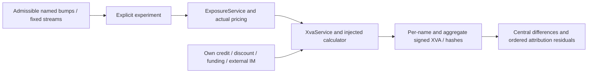

# XVA and revaluation workflow

Phase 7 adds a Python research interface, not a financial HTTP/CLI endpoint.
The operational API only checks health/readiness/version. Synthetic composition
lives in `src/parallax_risk/application/xva_examples.py` and `scripts/demo_xva.py`.

1. Supply a validated `XvaExperiment`: actual SimulationRequest, immutable legal
   book, matching conditional markets, accounts, ordered credit scenarios, own
   hazard/recovery, origin discount curve, FundingTerms, one external MarginProfile
   per counterparty, and fixed RunContext. Account/credit/model constraints retain
   their existing Phase 5/6 rules.
2. `XvaRevaluation.value` invokes ExposureService with those exact inputs. Actual
   production pricing generates residual exposure and credit/default evidence.
3. `XvaService.value` validates run/date/order/credit identities, injects its
   XvaCalculator and rejects stale input fingerprints. Independent CVA integrates
   EE with exact default masses; dependent scenarios use sampled grid loss. Own
   DVA and deterministic funding/IM follow separately declared approximations.
4. Domain `calculate` returns four signed components and FCA/FBA, with labelled
   intervals, input evidence and assumptions. The application adds per-name
   components without new legal netting and retains the exposure evidence digest.
5. `sensitivity` repeats this entire path at five admissible shifts with fixed
   stream addresses. It retains results, units and actual h/h2 difference.
6. `attribute` repeats ordered movements and separately values the actual end;
   omitted movements remain visible in component/total residuals.

Inputs are immutable. Failed types, dates, horizons, currency alignment, recovery,
funding magnitudes, result reconciliation and unsupported policies raise authored
ParallaxError subclasses. XvaService logs start/completed/failed with run ID and
error type only; raw exposures and terms are not automatically logged. There is
no import-time logger/settings/network initialization or new resource lifecycle.

Persist full inputs and runtime/source evidence externally if replay is needed.
In-memory hashes do not store them, authorize their use or establish lineage.
The example uses fixed synthetic metadata and no fabricated source commit.

[Credit/results](../methodology/XVA.md), [funding](../methodology/FUNDING_MARGIN.md),
[risk](../methodology/XVA_SENSITIVITIES.md), [code guide](../CODEBASE_GUIDE.md),
[limitations](../LIMITATIONS.md), [Phase 7 evidence](../validation/phase-7.md).
